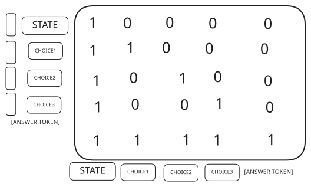
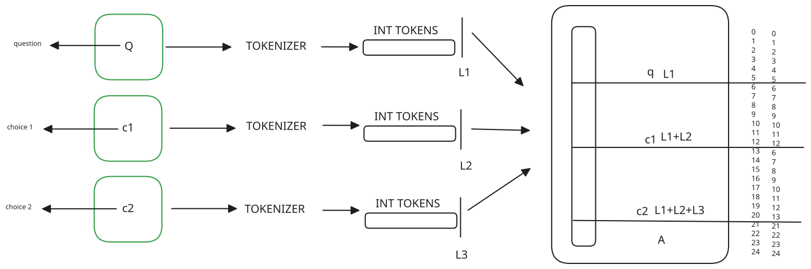

<p align="center">
  
</p>

# zerotok

Formerly RobSort.

Typed decisions from a local LLM by reading logits, without generating text.

## Contents

- [Quickstart](#quickstart-windows-powershell)
- [How it works](#how-it-works)
- [Project layout](#project-layout)
- [Branching backend (experimental)](#branching-backend-experimental)
  - [Attention mask](#attention-mask)
  - [Position ids](#position-ids)
  - [Training](#training)
- [Results](#results)
  - [Latency](#latency-qwen25-15b-instruct)
  - [Accuracy, zero-shot](#accuracy-zero-shot-qwen3-4b-instruct-2507-q8_0)
  - [Prefix caching](#prefix-caching-qwen3-4b-20-documents-x-4-decisions)
  - [Hardware](#hardware)
- [Limitations](#limitations)
- [Reproduce](#reproduce)
- [Credits](#credits)
- [License](#license)

## Quickstart (Windows, PowerShell)

```powershell
winget install ggml.llamacpp
.\start_server.ps1
```

In another terminal:

```powershell
python -m venv venv
.\venv\Scripts\Activate.ps1
pip install -r requirements.txt
uvicorn app:app
```

Open [http://127.0.0.1:8000](http://127.0.0.1:8000).

```powershell
curl -X POST http://127.0.0.1:8000/v1/decisions `
  -H "Content-Type: application/json" `
  -d '{"state":"Il cliente scrive: il pacco e arrivato danneggiato e vuole un rimborso urgente entro oggi.","decisions":[{"name":"urgenza","options":["Alta","Media","Bassa"]},{"name":"sentiment","options":["Negativo","Neutro","Positivo"]}]}'
```

```json
{
  "decisions": [
    {
      "name": "urgenza",
      "choice": "Alta",
      "probs": {"Alta": 0.9999999998, "Media": 0.0000000001, "Bassa": 0.0000000000},
      "latency_ms": 156.3
    },
    {
      "name": "sentiment",
      "choice": "Negativo",
      "probs": {"Negativo": 0.9999999999, "Positivo": 0.0000000000, "Neutro": 0.0000000000},
      "latency_ms": 45.4
    }
  ],
  "total_ms": 201.7
}
```

## How it works

Each decision costs a single forward pass instead of generating one token at a time: the model runs with `max_tokens: 1`, so no text is produced. The prompt is processed in parallel by llama.cpp, and only the logits of the letters allowed as options (A, B, C...) are read and turned into probabilities with softmax. The document is placed before the instructions in the prompt so that repeated decisions on the same document share an identical prefix. Prefix caching itself is a llama.cpp feature; this project's contribution is designing the prompt to exploit it and measuring the effect.

## Project layout

- `app.py`, `index.html`, `start_server.ps1`: API, dashboard and llama.cpp launcher.
- `src/`: code used by the app (`classify.py`, `prompt.py`, `logits.py`, `branching.py`, `head.py`).
- `scripts/`: everything run by hand (training, calibration, evaluation, benchmarks). Run from the repo root as modules, e.g. `python -m scripts.train_head`.
- `data/`: evaluation sets. `head/`: trained head and embedding caches (generated).

## Branching backend (experimental)

Alternative to the llama.cpp letter logits, selected with `ZEROTOK_BACKEND=branching` (head path override: `ZEROTOK_HEAD`, default `head/head.pt`). Qwen3-0.6B is frozen and runs one forward pass where each option is its own branch: options see the document but not each other, and share the same position ids, so the option order carries no signal. A small trained head (`ChoiceHead`) scores the last-token embedding of each branch.

### Attention mask

The prompt is one flat sequence: question, then each option back to back, then the answer tokens. A normal causal mask would let option 2 read option 1, so the model would see an order. The custom mask (`get_attention_mask`) removes it: rows are the query tokens, columns the keys, 1 means "can attend".



- The question is causal and sees only itself.
- Each option sees the whole question and itself (causal inside the option), never the other options. This makes the branches independent.
- The answer tokens see everything before them, then are causal among themselves. The last answer token is the one read for the answer embedding.

### Position ids

Independent branches also need independent positions, otherwise option 2 would look "later" than option 1 just because it comes after it in the sequence. `generate_position_ids` builds them like this:



- The question counts normally: `0 ... L1-1`.
- Every option restarts at the same position, `L1`, right after the question. Two options of 7 and 8 tokens get `6..12` and `6..13`.
- The answer tokens continue from their flat sequence index (the one after the last option), not from the end of the longest branch. With a 6-token question, options of 7 and 8 tokens and 4 answer tokens, the ids are `0..5, 6..12, 6..13, 21..24`.

The left column in the figure is the flat token index, the right one the position id.

### Training

- Trained on 5,000 examples from `avbiswas/bev-decision`, validated on 1,000 (split by state, so no document is in both).
- Validation accuracy: 58.6%, against 35.2% for an a-priori baseline that always picks the historically most frequent option (`scripts.baseline_prior`).
- Temperature scaling is fitted on the validation set by `scripts.calibrate_head` and saved in the checkpoint (T = 1.018). On validation the head was already close to calibrated (mean confidence 0.61 vs accuracy 0.59, ECE 0.054 to 0.043), so scaling changes little. It never changes which option wins.

```powershell
python -m scripts.train_head
python -m scripts.calibrate_head
$env:ZEROTOK_BACKEND = "branching"; uvicorn app:app
```

## Results

### Latency (Qwen2.5-1.5B-Instruct)

Same 110-token prompt, median of 20 requests after warm-up:

| Setup | Median latency |
|---|---|
| transformers bf16, in-process, GPU | 45.3 ms |
| llama.cpp, server-side compute | 20.5 ms |
| llama.cpp, end-to-end over HTTP | 36.2 ms |

The 20.5 ms and 36.2 ms figures were measured with Qwen2.5-1.5B-Instruct and an earlier version of `bench_latency.py`; running it again reproduces the same method and gives numbers of the same order, not identical ones. The 45.3 ms transformers figure was measured with a separate script that is not included in this repo. The previous version of this project ran on CPU by mistake (torch without CUDA), so most of the jump from that old version comes from fixing that, not from the runtime change. At equal GPU, the runtime gain is about 2x on compute and about 20% end-to-end.

### Accuracy, zero-shot (Qwen3-4B-Instruct-2507 Q8_0)

- SST-2: 88.0% (100 balanced examples from the validation split)
- AG News: 88.5%, macro F1 0.885 (200 balanced examples from the test split)

AG News errors concentrate on Business vs Sci/Tech.

### Prefix caching (Qwen3-4B), 20 documents x 4 decisions

| Document | First decision | Later decisions |
|---|---|---|
| Long (~500 tokens) | 188.8 ms end-to-end (130.3 ms server) | 44.4 ms end-to-end (23.5 ms server) |
| Short (~80 tokens) | 50.4 ms | 42.3 ms |

The cost of later decisions does not depend on document length: 10 decisions on a 500-token document take about 590 ms instead of about 1.9 s.

### Hardware

Laptop RTX 5060 8GB, i7-14650HX, 16GB RAM.

## Limitations

- With the llama.cpp backend, probabilities are overconfident, close to 0 or 1 even on wrong answers; do not use them as calibrated confidence. The branching head is better calibrated on its validation set, but it was not checked on out-of-distribution input.
- Accuracy drops with overlapping or ambiguous labels: on an internal set of 45 support tickets, accuracy was 51-60% depending on class names and order, with a systematic bias toward high severity.
- The 1.5B model showed a position bias toward option A.
- Single slot (`-np 1`): concurrent clients on different documents invalidate each other's cache.
- About 23 ms server-side is the floor per decision with this model and GPU; about 20 ms is HTTP/Python overhead.
- Contextual calibration was tested and had no effect.

## Reproduce

```powershell
python -m scripts.prepare_data
python -m scripts.evaluation data/sst2.json
python -m scripts.evaluation data/agnews.json
python -m scripts.bench_cache
python -m scripts.bench_latency
python -m scripts.train_head
python -m scripts.calibrate_head
python -m scripts.baseline_prior
```

`bench_latency.py` compares against the 20.5 ms / 36.2 ms figures above only if the server is started with Qwen2.5-1.5B-Instruct Q8_0 instead of the 4B model.

## Co-autori

Codice scritto con l'assistenza di:
- Claude Haiku 5.5 (Anthropic)
- Claude Opus 5.5 (Anthropic)

## Credits

Inspired by Jev (TypeSafe AI) and Rizzo Flow (Rizzo AI Academy).

## License

See [LICENSE](LICENSE).
